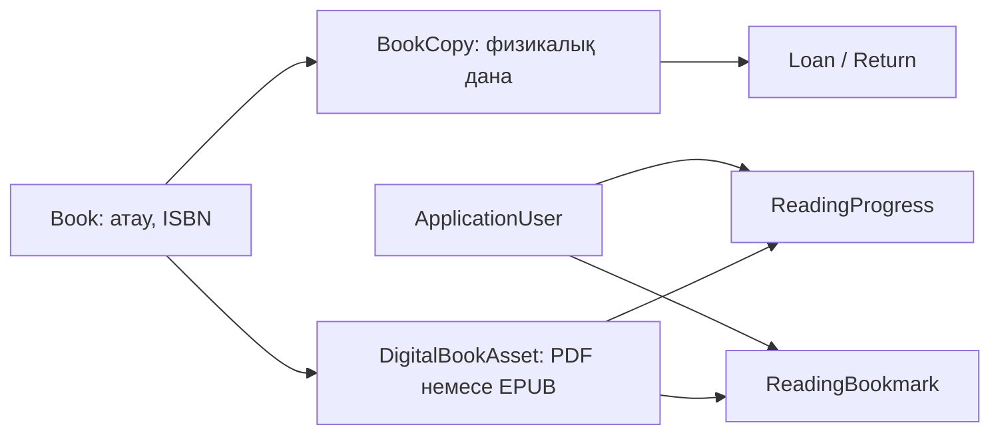

# EduLibrary жобасын түсіну

Бұл құжат кодты алғаш оқығанда негізгі бөліктер мен бизнес ережелердің байланысын көрсетеді. Алдымен [README.md](README.md) бойынша SQL Server-ді дайындап, қолданбаны іске қосыңыз.

## 1. MVC қалай жұмыс істейді?

**Model** деректерді сипаттайды: мысалы, `Book`, `Student`, `Loan`. **View** — пайдаланушы көретін Razor беті. **Controller** URL мен форма сұрауын қабылдап, сервисті шақырады және View немесе redirect қайтарады.

Мысалы, браузер `GET /Books` жібереді:

```text
Браузер → BooksController → ICatalogService → ApplicationDbContext → SQL Server
Браузер ← Razor View      ← ViewModel       ← сұрау нәтижесі
```

Формадағы `POST` сұрауында MVC алдымен Data Annotations арқылы енгізілген деректі тексереді. Controller `ModelState.IsValid` шартын қарайды; бизнес ережелерін сервис тексереді. Сәтті операциядан кейін redirect жасалады, сондықтан бетті жаңарту сол форманы қайта жібермейді.

## 2. DbContext деген не?

`Data/ApplicationDbContext.cs` — EF Core мен SQL Server арасындағы жұмыс сессиясы. Ол `IdentityDbContext<ApplicationUser>` класынан тарайды: бір контексте Identity кестелері де, кітапхана кестелері де бар.

`db.Books` — кітаптарға LINQ сұрауын құру нүктесі. `ToListAsync()` SQL сұрауын орындайды; `Add()` объектіні сақтауға дайындайды; `SaveChangesAsync()` өзгерістерді базаға жазады. EF мәндерді параметрлер арқылы жібереді. Оқуға арналған сұрауларда `AsNoTracking()` артық өзгеріс бақылауын азайтады.

Контекст DI арқылы әр HTTP сұрауына беріледі. Бір DbContext үстінде бірнеше EF сұрауын қатар орындауға болмайды; код оларды `await` арқылы ретімен орындайды.

## 3. Entity байланыстары

| Байланыс | Кодтағы мағынасы |
|---|---|
| Publisher → Books | Бір баспада көп кітап |
| Books ↔ Authors | Көптен-көпке, `BookAuthors` арқылы |
| Books ↔ Categories | Көптен-көпке, `BookCategories` арқылы |
| Book → BookCopies | Бір кітап сипаттамасында бірнеше физикалық дана |
| Student → Loans | Бір студентте көп кітап алу жазбасы |
| BookCopy → Loans | Бір дана уақыт өте бірнеше рет беріледі |
| Loan → Return | Әр беру жазбасына ең көбі бір қайтару |
| Loan / Student → Fines | Айыппұл нақты қарыз бен оқырманға тиесілі |
| Fine → FinePayments | Бір айыппұлға бірнеше ішінара төлем |
| Students ↔ Subjects | `StudentSubjects` арқылы |
| Student → StudentInterests | Оқырманның қызығушылықтар тізімі |
| Books ↔ Subjects | `BookSubjects` арқылы кітаптың нақты пәндік байланысы |
| Book / Student → Reviews | Бір студенттің кітапқа бағасы мен пікірі; жасыру және soft delete бар |
| ApplicationUser → Notifications | Белгілі бір аккаунтқа ғана көрінетін ішкі хабарлар |

**Book пен BookCopy — екі бөлек ұғым.** «Clean Code» туралы ISBN, автор, сипаттама `Book` ішінде; оның «A-01» сөресіндегі нақты данасы, штрихкоды мен мәртебесі `BookCopy` ішінде. Қарыз нақты данаға жасалады.

`Data/Configurations/LibraryConfiguration.cs` ұзындықтарды, міндетті өрістерді, FK байланыстарын, бірегей индекстер мен check constraints орнатады. Жою шектеулері кітап алу/төлем тарихының ата-анамен бірге жоғалуына жол бермейді. Архивтеу және белсенділікті тоқтату тарихи деректі сақтайды.

## 4. Controller → Service → DbContext

`Controllers/LoansController.cs` HTTP дерегін алады, авторизацияны тексереді және `ICirculationService` шақырады. `Services/Implementations/CirculationService.cs` кітап беруге бола ма деген шешімді қабылдап, транзакцияны орындайды. `ApplicationDbContext` SQL Server-мен жұмыс істейді.

`Services/Interfaces/` сервистің қандай операциялары барын көрсетеді. `Program.cs` интерфейс пен оның нақты класын `AddScoped` арқылы байланыстырады. `ILibraryClock` ағымдағы күнді анықтауды бір жерге жинайды; бұл кешігу есептерін тексеруді жеңілдетеді.

`ViewModels/` ішіндегі кластар экранға керек деректерді ғана береді. POST модельдеріндегі Data Annotations форманың тексерілуін анықтайды. Entity-ді тікелей форма ретінде байламау рұқсатсыз өрістердің өзгеру қаупін азайтады. Мысалы, студент профилі академиялық өрістерді сұраудан қабылдаса да, сервис оларды сақтамайды.

## 5. Кітап беру логикасы

`CirculationService.IssueAsync()` сценарийін оқыңыз:

1. Студенттің бар және белсенді екенін тексереді.
2. Нақты дананың қолжетімділігін, кітаптың архивтелмегенін және мерзімдердің дұрыстығын тексереді.
3. `Loan` жасайды, сол дананы `OnLoan` күйіне ауыстырады.
4. Өзгерістерді бір SQL транзакциясында сақтайды.

Транзакцияның мағынасы: барлық өзгеріс бірге сақталады немесе бірге кері қайтады. Дана мәртебесі өзгеріп, `Loan` жазбасы сақталмай қалмайды.

`BookCopy.RowVersion` — SQL Server автоматты жаңартатын concurrency белгісі. Екі қызметкер бір дананы бір уақытта берсе, ескі нұсқамен жазу қабылданбайды. Қосымша бірегей filtered index бір данаға екі белсенді `Loan` жазбасын сақтатпайды. Қате түсінікті бизнес хабарламасына айналады.

## 6. Кітап қайтару логикасы

`CirculationService.ReturnAsync()` белсенді қарызды жүктеп, қайтару күнін және дананың жағдайын тексереді. Кейін:

- `ReturnedAt` толтырады;
- `Return` жазбасын жасайды;
- жақсы дананы `Available`, зақымданған дананы `Damaged` етеді;
- кешігу болса нақты `Fine` жасайды;
- бәрін бір транзакцияда сақтайды.

Қайтарылған қарызды қайта қайтаруға болмайды. `Loan` тарихы жойылмайды; Dashboard келесі сұрауда жаңа SQL күйінен статистиканы есептейді.

## 7. Айыппұл есебі

`Library:FinePerOverdueDay` бастапқыда **100 ₸**, `Library:DefaultLoanDays` — **14 күн**. Мәндер `Helpers/LibraryOptions.cs` арқылы оқылады және іске қосылғанда тексеріледі.

```text
Кешігу = max(0, (қайтару күні немесе бүгін) − DueDate)
Сома   = кешігу күндері × күндік тариф
Қалдық = Amount − PaidAmount
```

Кешігу күн бойынша есептеледі; кітапхананың күні `Asia/Qyzylorda` белдеуінен алынады. Қайтарылмаған кітаптың сомасы болжам. Қайтарғанда сома бекітіліп, кейінгі күндерге өспейді. Ақша үшін `decimal` қолданылады.

`PayFineAsync()` оң төлем сомасын және оның қалдықтан аспайтынын тексереді. `FinePayment` жазбасы мен жиынтық `PaidAmount` бірге сақталады. Қалдыққа байланысты `Unpaid`, `PartiallyPaid`, `Paid` мәртебелері қойылады. Бұл операция сыртқы төлем жүйесін шақырмайды: қызметкер қабылданған төлемді тіркейді.

## 8. Identity және рөлдер

Identity парольдерді хэш түрінде сақтайды және cookie арқылы кіру сессиясын басқарады. `ApplicationUser` стандартты пайдаланушыға `FullName` қосады. Пайдаланушы мен студент `Student.IdentityUserId` арқылы байланысады; әр оқырманға міндетті түрде онлайн аккаунт қажет емес.

| Рөл | Жауапкершілік |
|---|---|
| Admin | Барлық басқару, кітапханашы аккаунттары, баптаулар |
| Librarian | Каталог, студенттер, беру, қайтару, айыппұлдар |
| Student | Каталог, өзінің тарихы/айыппұлдары, жеке профиль |

`[Authorize]` және `[Authorize(Roles = "...")]` endpoint-терді шектейді. Бұған қоса сервистегі сұраулар студенттің деректерін `IdentityUserId` бойынша шектейді: URL-дегі басқа `id` басқа адамның тарихын ашпайды.

Өзіндік тіркелу әрдайым `Student` рөлін береді; бұрынғы студент нөмірін иемденбейді. Identity аккаунты мен Student бір транзакцияда жасалады. Кітапханашыны тек Admin қосады; тоқтатқанда lockout пен security stamp өзгереді. Cookie әр сұрауда stamp арқылы тексеріледі. Шығу және дерек өзгертетін сұраулар POST + anti-forgery token арқылы қорғалған.

Екінші кезеңде осы шектеу ұсынымдарға, оқу бағытына, пікірді өңдеуге және хабарландыруларға да қолданылады. `RecommendationsController` қызметкер рөлін өзі есептеп, сервис сұрауын `IdentityUserId` бойынша шектейді; студент басқа `studentId` берсе, профиль табылмайды. `NotificationService` әр сұрауға `UserId == currentUserId` шартын қосады. Есеп/талдау және QR беттерін тек қызметкерлер ашады; пікір модерациясын тек Admin орындайды.

## 9. Migrations пен Seed айырмасы

**Migration** кестелердің құрылымын өзгертеді; оның файлдары `Data/Migrations/` ішінде. **Seed** сол құрылымға бастапқы дерек енгізеді; коды `Data/Seed/DbSeeder.cs` ішінде. `SeedHistory` аяқталған демо толтыруды белгілеп, қайталанған іске қосуда duplicate жазбаларды болдырмайды.

Production ортасында демо студенттер мен парольдер жасалмайды. Development парольдері конфигурациядан алынады; кодта ортақ әдепкі пароль жоқ. Бағдарлама SQL қосылымын талап етеді және қатені fake деректермен жасырмайды.

Екінші кезеңнің `IntelligentLibrary` migration-ы жаңа `BookSubjects`/`Notifications` кестелерін, Review өрістерін және индекстерді қосады. Бар каталог санаттарынан тек жаңа пәндік байланыстар толтырылады. `ReportingIndexes` уақыт аралығымен сұралатын бағандарға индекстер қосады. Негізгі база өшірілмейді; seed қайталанбайды. Үш migration қолданылғаннан кейін бастапқы 36 кітап/106 дана/18 студент/14 беру/5 қайтару/3 айыппұл сақталғаны тексерілген.

## 10. Жеке ұсыныс қалай құралады?

Негізгі файлдар: `RecommendationService.cs`, `RecommendationScoring.cs`, `RecommendationViewModels.cs`, `RecommendationOptions.cs`, `Views/Recommendations/`.

`RecommendationService.GetAsync()` алдымен рұқсат етілген студенттің қызығушылықтарын, пәндерін, факультетін, кітап алу тарихын және ашық пікірлерін SQL-ден алады. Кандидаттар — архивтелмеген нақты кітаптар. Қазір қолдағы кітап әрқашан алынып тасталады; әдепкіде бұрын алынған немесе ашық пікір жазылған кітап та алынады. «Бұрын оқылған кітаптарды да қосу» осы екінші шартты ғана босатады.

SQL projection кітап метадеректерін, автор/санат/пән байланыстарын, бос дана санын, беру санын және ашық орташа рейтингті алады. `AsNoTracking` пен `AsSplitQuery` оқуға арналған жүктеуді жеңілдетеді; әр кітапқа бөлек сұрау жасалмайды. Бастапқы шек — қолжетімділігі/танымалдығы бойынша қаралатын 2000 кандидат. Бұл шекке жетсе, интерфейс оны жасырып қалмайды.

Әр кандидат төрт нормаланған фактормен бағаланады. Кейін алты бөлек көрініс жасалады: жалпы сәйкестік, пәндер, қызығушылықтар, оқу тарихына ұқсастық, сол факультетте алынған кітаптар, таныс санаттардан тыс жаңа бағыт. Бір кітап бірнеше бөлімде болуы мүмкін; бұл бір каталог кітабының әртүрлі себеппен сәйкес келуі.

## 11. Relevance Score нақты қалай есептеледі?

Барлық фактор 0–1, соңғы сәйкестік 0–100 аралығында. Кодты `RecommendationScoring.Score()` және `Factors()` әдістерінен оқыңыз.

| Фактор | Кодтағы есеп |
|---|---|
| Қызығушылық | Мәтін кіші әріпке, сөздерге және шағын үштілді ұғымдар сөздігіне келтіріледі. Әр қызығушылық үшін кітап мәтінінде табылған сұралған токендердің үлесі алынып, нәтижелер орташаланады |
| Пән | Нақты `BookSubjects` байланысы болса 1; болмаса `0.75 × мәтіндік сәйкестік`. Студент пәндері бойынша орташа есептеледі |
| Оқу тарихы | `0.55 × санат жақындығы + 0.35 × автор жақындығы + 0.10 × пән жақындығы`, соңында 0–1 шегіне келтіріледі |
| Танымалдық/рейтинг | Факультет дерегі барда `0.45 × жалпы танымалдық + 0.35 × рейтинг + 0.20 × факультет танымалдығы`; ондай дерек жоқта `0.60 × жалпы танымалдық + 0.40 × рейтинг` |

Тарихтағы әр кітаптың дәлелі: `min(3, беру саны) + 0.5 × (өз бағасы − 3)`. Баға болмаса, екінші бөлік 0. Осы салмақтар автор/санат/пән кілттеріне қосылады; жақындық ең үлкен абсолют салмақпен нормаланады. Төмен баға кей бағытқа жақындықты азайта алады. Жасырылған/жойылған пікір бұл есепке кірмейді.

Танымалдық: `log(1 + беру саны) / log(1 + кандидаттардағы ең көп беру саны)`; дерек жоқ болса 0. Рейтинг: `((орташа баға − 1) / 4) × n / (n + 5)`, мұнда `n` — ашық пікір саны. Сондықтан жалғыз 5 жұлдыз көп пікірмен расталған рейтингпен бірдей салмақ алмайды.

Төрт негізгі салмақ бастапқыда **30/25/25/20**. Толық профиль үшін:

```text
Score = 100 × (0.30 × interest + 0.25 × subject + 0.25 × history + 0.20 × popularity)
```

Мысалы, факторлар `1, 0.5, 0.2, 0.8` болса: `30 + 12.5 + 5 + 16 = 63.5%`. Салмақтар `Recommendations` конфигурациясынан оқылады және оң жиынтыққа нормаланады.

Қызығушылық/пән/тарихтың бірі жоқ болса, сол салмақ 0 болып, қалған салмақтар қайта нормаланады. Үшеуі де жоқ cold-start жағдайда нақты танымалдық/рейтинг/факультет дәлелі қалады. Барлық статистика нөл болса, нөл сәйкестік шынайы көрсетіледі. Бұл кезде кітаптарды танысу үшін ашуға болады; дәлел ойдан жасалмайды.

`Rank()` әуелі бос данасы бар кітаптарды, кейін сәйкестік ұпайын, бос дана санын, беру санын және тұрақты Book ID-ді қолданады. Сондықтан қолжетімділік — жеке сұрыптау басымдығы; ол жасырын кездейсоқ үстеме ұпай емес. Карточкадағы кесте әр фактордың мәнін, нақты салмағын және соңғы ұпайға үлесін ашады.

Ұсыныстан `/Books/Details/{id}` бетіне өткенде `RecommendationContextService` соңғы бағаны 15 минутқа сақтайтын қорғалған query токенін береді. ASP.NET Data Protection токенді viewer Identity ID-іне және Book ID-іне байлайды. `BooksController.Details()` осы байланыс пен мерзімді тексереді; жарамсыз/өзгертілген/бөтен viewer не кітап токені болса, жеке ұпай көрсетілмейді. Жай каталог әдеттегідей ашылады. Бұл жерде engine немесе сыртқы LLM қайта орындалмайды.

## 12. Түсіндірме және сыртқы AI

`RecommendationExplanationService` барлық таңдалған кітапқа алдымен `TemplateExplanationProvider` арқылы нақты дерекке негізделген қазақша түсіндірме жазады. `Recommendations:Llm:Enabled` әдепкіде `false`; сыртқы API жоқ болса, осы мәтінмен толық жұмыс істейді.

Қосылған `OpenAICompatibleExplanationProvider` бір batch HTTP сұрауымен тек түсіндірме сұрайды. Оған студент профилі түгел жіберілмейді: уақытша `item0` токені, кітап метадеректері, пән сәйкестігі және қауіпсіз академиялық ұғымдар беріледі. Студент аты/поштасы/телефоны/нөмірі/ID/факультеті мен еркін қызығушылық мәтіні жіберілмейді. API кілті сервер конфигурациясында қалады.

Provider HTTPS endpoint-ін тексереді, redirect жасамайды, timeout пен жауап көлемін шектейді. Қате, жарамсыз JSON, кілттің болмауы немесе timeout local мәтінді сақтайды. Жауаптағы тек берілген токендер қабылданады; модель жаңа кітап қоса алмайды, ranking-ті/рөлдерді/деректерді өзгертпейді және еш құрал шақырмайды. Razor мәтінді кодтайды. **LLM-enhanced explanations** тек нақты қабылданған жауап барда көрсетіледі. Тірі сыртқы модельмен тексеру орындалмаған; unit tests fake HTTP transport арқылы fallback-ті тексереді.

## 13. Analytics қалай құралады?

`AnalyticsController` және `AnalyticsService.GetAsync()` ортақ `ReportingRules.ResolvePeriod()` арқылы кезеңді анықтайды. Күндік кітап айналымы кітапхана күндерімен, UTC-де сақталған пікір/төлем уақыттары сол жергілікті кезеңнің UTC шекараларымен сүзіледі. Аяқталу күнін толық қосу үшін SQL шарттары `[start, end + 1 күн)` түрінде құрылады.

Қор, қолжетімділік, белсенді қарыз және бекітілген берешек — бүгінгі snapshot. Кезеңдегі оқырмандар, төлемдер және бағалар — уақыт аралығындағы activity. Бұл айырма карточка түсіндірмелерінде көрсетілген.

SQL `GroupBy`, `Count`, `Sum`, `Average` арқылы жеті график дерегін есептейді: беру, қайтару, танымал кітаптар, санаттар, кешігу, оқырмандар, рейтингтер. 90 күннен ұзақ кезең айларға топталады; бос күн/ай кодта нөлмен толтырылады. Санат графигі бірегей берілген кітапты оның әр санатында санайды; кешігу графигі мерзімі кезеңге түскен кешігу оқиғаларын көрсетеді.

`Views/Analytics/Index.cshtml` бастапқы деректі, ал `/Analytics/Data` JSON жаңартуын береді. `wwwroot/js/analytics.js` Chart.js графиктерін құрып, кезең мен theme өзгергенде жаңартады. SQL рұқсаты тек Admin/Librarian endpoint-тері арқылы беріледі.

## 14. Бес есеп SQL деректерін қалай алады?

`ReportingService` бір `ReportFilterViewModel` қабылдап, түрге қарай бес әдістің бірін орындайды: `LoansAsync`, `PopularAsync`, `OverdueAsync`, `ReadersAsync`, `RatingsAsync`. Олар іздеу, кезең, санат, факультет және тиісті мәртебе шарттарын SQL сұрауына қосады. Экран үшін 20 жолдық беттеу бар; экспорт пен баспа барлық сүзілген жолды алады.

Алғашқы төрт есептің кезеңі — **берілген күн**. Қайтарылған/кешіккен санағы сол берулердің ағымдағы не нақты қайтарылған кездегі күйі; «кезеңде қайтарылды» деген бөлек көрсеткішпен шатастырмаңыз. Rating есебінің кезеңі — ашық пікірдің `CreatedAt` уақыты; кітаптың беру саны да сол кезеңмен шектеледі. Рейтингсіз кітап есепке ойдан қосылмайды.

Оқырман белсенділігі: `max(0, 3 × беру + 2 × қайтару − 2 × кешігу)`. Танымалдық/рейтинг орындары тең мәндерге бірдей беріледі. Қайтарылмаған кешіккен кітапқа болжамды айыппұл, қайтарылғанына бекітілген `Fine.Amount` көрсетіледі. Автор атаулары беттегі кітаптар үшін бір batch сұрауымен алынады.

`ReportingRules.CreateCsv()` UTF-8 BOM және CSV дәйексөздерін дайындайды. `CsvField()` бос орын/басқару таңбаларынан кейін де формула болып танылатын `=`, `+`, `-`, `@` басына апостроф қосады. Экспортта да сол рөл/сүзгі шектеулері сақталады. `Views/Reports/Index.cshtml` бір модельді экран мен print режиміне бейімдейді; `reports.js` баспа әрекетін орындайды.

## 15. Notifications қалай жасалады?

`Notification` жазбасында `UserId`, түр, мәтін, сілтеме, `CreatedAt`, `ReadAt` және бірегей `DeduplicationKey` бар. Хабарлар SQL-де сақталады, сондықтан сервер қайта қосылса жоғалмайды.

`CirculationService.InTransactionAsync()` беру/қайтару/айыппұлдың жасалған объектілерін сақтап, commit-ке дейін `WorkflowNotificationWriter.AppendAsync()` шақырады. Осылайша операция мен оның хабары бірге бекітіледі немесе бірге кері қайтады. Аккаунтпен байланысқан студентке ғана ішкі хабар жасалады.

`ReminderBackgroundService` іске қосылғанда және әр 30 минутта `GenerateRemindersAsync()` орындайды. Белсенді қарыздың мерзіміне 3 күн/1 күн қалса немесе өтіп кетсе, еске салу жасалады. SQL транзакциясындағы `sp_getapplock` бірнеше server instance арасын үйлестіреді; unique key — екінші қорғаныс. Кілт: `түр:loanId:dueDate`; бір overdue ескертпесі күн сайын қайта жасалмайды.

`NotificationBellViewComponent` тақырыптағы санау мен соңғы хабарларды алады. `NotificationsController` тізім/біреуін оқу/бәрін оқу әрекеттерін ұсынады. `NotificationService` әр query/update-ті `UserId` бойынша шектейді; бөтен ID оқылды деп белгіленбейді. Email/SMS provider бұл модульде жоқ.

## 16. Reviews, QR және ақылды іздеу

`ReviewService` студенттің 1–5 бағасын, ұзындықты, меншікті студент жазбасын және бір белсенді пікір шартын тексереді. `IsDeleted` жою тарихын, `IsHidden` әкімші модерациясын сақтайды. `ReviewPolicy` RowVersion мәнін тексереді; ескірген форма басқаның өзгерісін өшірмейді. `BookReviewsViewComponent` ашық орташа баға/санды және өз пікірін Book Details ішіне береді.

`CopyCode.CreateQrSvg()` QRCoder арқылы тек бірегей дана штрихкодын кодтайды. `CopyLookupService` алдымен Barcode, кейін InventoryNumber бойынша іздейді. Сканер мәтінін сыртқы URL ретінде ашпайды. `scanner.js` камераны тек пайдаланушы батырмасымен қосады: native BarcodeDetector немесе ZXing QR, ал рұқсат/құрылғы болмаса қолмен енгізу бар. QR оқу тек іздеуді жылдамдатады; кітап беру/қайтару бұрынғы транзакциялық сервиспен орындалады.

`CatalogService.GetBooksAsync()` SQL-де барлық search/filter/sort шарттарын қолданады, содан кейін беттейді. `BookSubjects` пән іздеуіне қатысады; рейтинг тек ашық пікірлерден алынады. `catalog.js` 320 ms debounce, AbortController, AJAX partial, browser history және тор/тізім таңдауының localStorage күйін басқарады. Серверлік GET форма JavaScript жоқта да қалады.

## 17. Маңызды файлдар және кодты оқу реті

1. `Program.cs`: DI, Identity, SQL Server, middleware және startup.
2. `Models/Entities/LibraryEntities.cs`, `Models/Enums/LibraryEnums.cs`: негізгі деректер.
3. `Data/ApplicationDbContext.cs`, `Data/Configurations/LibraryConfiguration.cs`: EF сәйкестендіруі.
4. `Services/Interfaces/`: модульдердің келісімдері.
5. `Services/Implementations/CatalogService.cs`: іздеу және CRUD.
6. `Services/Implementations/CirculationService.cs`: беру, қайтару, айыппұл және транзакциялар.
7. `Services/Implementations/AccountService.cs`, `StudentService.cs`: Identity, рұқсаттар және профиль.
8. `Controllers/`, `ViewModels/`, `Views/`: сұраудың экранға дейінгі толық жолы.
9. `Services/Implementations/RecommendationService.cs`, `RecommendationScoring.cs`, `RecommendationExplanationService.cs`, `OpenAICompatibleExplanationProvider.cs`, `RecommendationContextService.cs`: жеке ұсыныс, түсіндірме және каталогқа қорғалған ұпай тасымалдау.
10. `Services/Implementations/ReportingRules.cs`, `ReportingService.cs`, `AnalyticsService.cs`: кезең, экспорт, бес есеп және график сұраулары.
11. `Services/Implementations/ReviewService.cs`, `Helpers/ReviewPolicy.cs`, `ViewComponents/BookReviewsViewComponent.cs`: пікір/рейтинг/модерация.
12. `Services/Implementations/CopyLookupService.cs`, `Helpers/CopyCode.cs`, `wwwroot/js/scanner.js`: QR және дана іздеуі.
13. `Services/Implementations/NotificationService.cs`, `WorkflowNotificationWriter.cs`, `ReminderBackgroundService.cs`, `ViewComponents/NotificationBellViewComponent.cs`: SQL хабарлар және дедупликация.
14. `Views/Recommendations/`, `Views/Reports/`, `Views/Analytics/`, `Views/Reviews/`, `Views/Notifications/`, `Views/Copies/`: жаңа экрандар.
15. `wwwroot/js/catalog.js`, `recommendations.js`, `analytics.js`, `reports.js`, `site.js`, `theme.js`: браузердегі өзара әрекет.
16. `Data/Migrations/`, `Data/Seed/DbSeeder.cs`: schema тарихы мен оқу жинағы.
17. `tests/EduLibrary.Tests/`, `tests/EduLibrary.IntegrationChecks/`, `tests/EduLibrary.FeatureChecks/`, `tests/http_smoke.py`, `tests/phase2_http_smoke.py`: unit, нақты SQL және HTTP тексерулер.

Визуалды қайта құру алдындағы функционалдық тексеру: **107 xUnit, 79 негізгі SQL, 60 жаңа функция SQL, 151 негізгі HTTP және 271 екінші кезең HTTP** тексеруі өтті; қате жоқ. Екі SQL harness тек өздері жасаған кездейсоқ уақытша базамен жұмыс істеп, оны тазартты. HTTP тексерулер негізгі деректерге сәтті mutation орындамайды. Осы бұрынғы нәтижелер жаңа интерфейстің визуалды тексеруін алмастырмайды. Соңғы дизайнға қатысты нәтижелер README тексеру бөлімінде бөлек беріледі.

## 18. Design System, Layout Architecture және Razor Components

Жаңа интерфейс кітап пен білімге арналған редакциялық орта ретінде құрылады. Оның түсі мен қарпі әр бетте бөлек ойлап табылмайды: `wwwroot/css/site.css` ішіндегі `--color-*`, `--font-ui`, `--font-editorial` токендері қолданылады. Manrope негізгі мәтінді, Noto Serif тақырыптарды береді; жергілікті қаріптер `fonts.css` арқылы тіркеледі. Ашық және қараңғы тақырып токендерді ғана ауыстырады, сондықтан бір компонент екі режимде де жұмыс істейді.

`Views/Shared/_Layout.cshtml` — экран қаңқасы. Ол Admin/Librarian пайдаланушысына `_AdminNavigation` ықшам rail-ін қосады. Оқырманға `_AppHeader` ішіндегі `_StudentNavigation` жоғарғы мәзірі беріледі. Мобильді мәзірдің ашылуы, тақырып ауыстыру, toast және растау диалогы `wwwroot/js/site.js` арқылы басқарылады. Қай бет ашылса да, бизнес рұқсаттары Controller пен Service қабатында қалады.

`_BookCover.cshtml` кітап метадеректерінен редакциялық мұқаба жасайды. Нақты сурет бар болса, сурет сол мұқабаның үстінде көрсетіледі. `_BookCard.cshtml` мұқаба, автор, баға және қолжетімділікті бір рет анықтап, каталогта қайта пайдаланады. Бұл partial-дар SQL сұрауын орындамайды; дайын ViewModel-ді көрсетеді. `BookReviewsViewComponent` сияқты компоненттер деректерді сервис арқылы алып, өз көрінісіне береді.

Басқару беттері `management.css` компоненттерінен құралады: `workspace-heading` — бет тақырыбы; `ledger-panel`, `data-ledger`, `ledger-caption` — тізілім; `form-section-heading` — нөмірленген форма бөлігі; `record-grid` — жазба мәліметтері. Dashboard жеке `overview-metrics`, `operations-layout`, `overdue-agenda`, `popular-ledger` құрылымын пайдаланады. Сондықтан әр бет бірдей үлкен баннер мен статистика карточкаларының көшірмесіне айналмайды.

Оқырманның `Loans` көрінісі мен `Students/Details` оқылған кітаптарды типографиялық сөре ретінде көрсетеді. `Notifications/Index` хат-хабар журналына ұқсайды. Reports баспа режимінде навигацияны жасырып, барлық сүзілген жолды береді; QR жапсырмасы ақ қағазға бейімделген. `analytics.js` Chart.js түстерін орталық токендерден оқиды және тақырып өзгергенде графикті қайта салады.

Кең кесте тек `.table-responsive` контейнерінде айналдырылады. CSS media query-лері тар экранда бағандарды азайтады; батырма нысандары мен мәтін өлшемі оқуға ыңғайлы сақталады. Бұл — интерфейс қабаты: entity, migration, loan/fine транзакциялары және авторизация ережелері визуалды стильдерге тәуелді емес.


`ReadingSpaceController` тек Student рөліне қолжетімді. `IReadingSpaceService` ағымдағы Identity ID арқылы студентті тауып, өзінің белсенді кітаптарын, қайтарылған тарихын, бекітілген айыппұлдарын, қызығушылықтарын және хабарларын SQL-ден құрайды. Сырттан студент ID қабылдамайды. Жеке ұсыныстар бұрынғы сервиспен есептеліп, кітапқа өту ұпайы бұрынғы қорғалған токенмен беріледі. `RelatedBooksViewComponent` ұқсас автор/санаты бар нақты, мұрағатталмаған кітаптарды read-only сұраумен алады. Домен моделі мен migration өзгермейді.

Тесттер: `editorial_ui_smoke.cjs` рөл × тақырып × viewport матрицасын, overflow, алғашқы мұқаба орны, баған саны, JavaScript қателері және мәзір/search келісімдерін тексереді. `editorial_interactions.cjs` нақты батырмалар мен сүзгілерді іске қосады; архивтеуді растаудан бас тартады, бос форманы валидациялайды және JavaScript өшірілген GET іздеуін тексереді. Негізгі базаға сәтті мазмұндық mutation орындалмайды. Соңғы нәтиже: 107 unit, 79 + 64 SQL, 156 + 283 HTTP, 375 + 13 browser тексеруі өтті. PNG/JSON есептері `artifacts/editorial-ui/` ішінде.

## 19. Онлайн бронь, кезек және физикалық тапсыру

`Reservation` — Loan-нан бөлек бизнес жазбасы. `BookId` пен `StudentId` міндетті; `BookCopyId` кезекте бос болады, нақты дана бөлінгенде толтырылады. `LoanId` тек физикалық беру сәтінде пайда болады. Кестеде UTC appointment/expiry/audit уақыттары, алып кету орнының конфигурациялық ID-і, 128-bit кездейсоқ pickup code және SQL `RowVersion` сақталады. `PreparedByUserId` / `CancelledByUserId` әрекет авторын тіркейді. `20261019204748_OnlineReservations` тек қосымша схема мен `CopyStatus.Reserved` үшін кеңейтілген check constraint қолданады.

Студенттің сұрауы `ReservationsController` → `IReservationService.CreateAsync()` арқылы өтеді. Сервис нақты Student рөлін, белсенді әрі бұғатталмаған аккаунтты, өзінің Student профилін, мұрағатталмаған кітапты, қайталанбайтын active reservation мен осы кітапқа active loan жоқтығын тексереді. Бос дана `Reserved`, бронь `Pending` болады; дана болмаса `Queued` жазбасы құрылады. Кітапты `Reserved` күйінде кәдімгі Loans/Create арқылы беру мүмкін емес.

Кезектің тәртібі — `CreatedAtUtc`, содан соң `Id`. `ReservationCoordinator.ReconcileAsync()` expiry мен жарамсыз кітап/оқырманды өңдеп, бос дананы бірінші жарамды queued оқырманға бөледі. Жылжыту сәтінде appointment пен сол орын/уақыттың сыйымдылығы қайта тексеріледі. Ескі уақыт өтіп кетсе, келесі ашық бос слот алынады. `CirculationService` қайтару операциясы да осы coordinator-ды commit-ке дейін шақырады: қайтарылған жарамды дана бірден кезектегі оқырманға сақталады.

`ReservationSchedule` кітапхана уақытын `Asia/Qyzylorda` арқылы UTC-ге/кері ауыстырады. Ашық күн, басталу/аяқталу уақыты, слот торы, алдын ала келу аралығы және күн көкжиегі серверде тексеріледі. Браузердегі `/Reservations/Slots` — сол SQL сыйымдылығын көрсету құралы; POST кезінде тексеру қайта орындалады. `HoldDeadline()` конфигурациялық hold пен appointment grace ішінен кеш аяқталатын уақытты алады, сондықтан болашақ appointment келмей тұрып бронь өшпейді.

Librarian `MarkReadyAsync()` кезінде сол кітапқа тиесілі нақты бос/бөлінген дананы таңдайды. Сервис рөл мен RowVersion-ды қайта тексеріп, `ReadyForPickup`, дайындалған уақыт, қызметкер ID-ін және жаңартылған expiry-ді сақтайды. Бұл қадамда Loan жоқ. Pickup формасында код алдын ала толтырылмайды: қызметкер студенттің телефонынан көрсетілген кодты енгізуі керек. `ReservationPickupCode` криптографиялық 16 random byte-ты `ELR-` + 32 hex түрінде береді; кодта студент дерегі жоқ. Салыстыру қалыпқа келтірілген толық мәнге constant-time әдісімен орындалады. Lookup — POST+CSRF; QR тек owner немесе staff үшін ашылады, cache сақтамайды.

`FulfillAsync()` рөлді, deadline-ды, status-ты, RowVersion-ды, кодты, оқырманды, copy status-ты және қайтару күнін тексереді. Бір SQL транзакциясында Loan жасалып, бронь `Fulfilled` болады, copy `OnLoan` күйіне өтеді, `Issued:{loanId}` хабары жазылады. Кітапты қолына берген күн — `ILibraryClock.Today`; онлайн өтінім жіберген күн емес. Екінші рет басу немесе қатар орындау жаңа Loan жасамайды.

Барлық өзгерістер Serializable транзакцияда ортақ `EduLibrary.Reservations.v1` `sp_getapplock` құлпымен орындалады. Loan issue/return осы құлыпты қолданады. SQL filtered unique индекстері бір Student+Book үшін бір active броньға, бір copy үшін бір active hold-қа және бір Loan үшін бір fulfillment-ке ғана рұқсат береді. Composite foreign key reservation-дағы copy-дің дәл сол Book-қа, Loan-ның дәл сол Student-ке тиесілігін қосымша қорғайды. Expected conflict пен сақтау қатесі қазақша `BusinessException` береді; commit жасалмаған өзгерістер бірге кері қайтады.

`ReservationBackgroundService` scope ашып `ProcessAsync()` орындайды. Қатар worker-лер де сол транзакциялық құлыпты алады. Мерзім аяқталғанда ready/pending hold `Expired` болады, copy босайды және FIFO жылжиды. Хабарлардың тұрақты кілттері: `ReservationCreated`, `ReservationQueued`, `ReservationReady`, `ReservationPromoted`, `ReservationExpired`, `ReservationCancelled`, `ReservationExpiring` + reservation ID. SQL notification unique index пен сол транзакция қайталама ескертуге және операциясыз хабарға жол бермейді. Worker қатесі келесі конфигурациялық интервалда қайта өңделеді.

`tests/EduLibrary.Tests/ReservationRulesTests.cs` таза кесте/уақыт/код ережелерін тексереді. `tests/EduLibrary.ReservationChecks` жеке random SQL базасында migration-нан бастап толық сценарийді орындайды: hold/queue, concurrent last copy мен slot, stale форма, бөтен ownership, role, pickup, Loan/history, cancel/return promotion және concurrent expiry/reminder. Хабарландыруға уақытша CHECK constraint қою арқылы creation/ready/fulfillment/cancel/expiry өзгерістерінің rollback-і SQL-ден қайта оқылып тексеріледі. Constraint пен бүкіл тест базасы тек осы harness-ке тиесілі. `tests/reservations_ui_smoke.cjs` бөлек 5399 қосымшасында нақты формаларды басып, POST код іздеуі, handover, қайтару және FIFO мәртебелерін көрсетеді; негізгі деректер базасына жазбайды.

Reservation қосылғаннан кейін осы тексерулердің нақты нәтижесі: **83 SQL, 94 read-only HTTP, 153 браузер тексеруі өтті; қате жоқ**. 153 browser assertion ішіндегі 96-сы Student/Staff экрандарының light/dark және 360/390/768/1024/1440/1920 px матрицасына тиесілі. Таза ережелерге 16 жаңа xUnit case қосылды; жалпы unit саны соңғы README тексеру кестесінде тіркеледі. SQL harness өзінің базасын тазартты; successful browser workflow тек бөлек UI базасын пайдаланды. `artifacts/reservation-ui/` ішіндегі PNG-де pickup code пен QR әдейі жасырылған; камера құрылғысы тексерілмеген.

## 20. ASP.NET Core Localization деген не?

Localization — бір бағдарламаның бірдей функциясын пайдаланушы таңдаған тілмен көрсету. Кітаптың атауын немесе сақталған ISBN-ін қайта жазу емес. Осы жобада `kk-KZ`, `ru-RU`, `en-US` culture қолданылады. `CurrentUICulture` мәтінді таңдаса, `CurrentCulture` күн, сан және ақша пішімін анықтайды. Мысалы, бір SQL күні қазақша және ағылшынша интерфейсте әртүрлі қысқа пішіммен көрсетілуі мүмкін; оның базадағы мәні өзгермейді.

Нақты конфигурация `Program.cs` ішінде: `AddLocalization`, MVC `AddViewLocalization`, `AddDataAnnotationsLocalization`, supported cultures және `UseRequestLocalization`. `SharedResource.cs` — ресурстың қай assembly-ден табылатынын көрсететін marker class; `Localization/UiText.cs` — сервистерге арналған ортақ lookup құралы. Бизнес ережесі аудармаға тәуелді емес: рөл атауы, enum мәні, ISBN, SQL constraint немесе queue key аударылмайды.

## 21. IStringLocalizer және IViewLocalizer қалай жұмыс істейді?

`Views/_ViewImports.cshtml` барлық Razor бетіне `IStringLocalizer<SharedResource>` түріндегі `T` объектісін береді. `@T["Profile photo"]` ағымдағы UI culture бойынша SharedResource ішінен мән іздейді. Resource value HTML ретінде сенімсіз енгізілмейді: Razor қалыпты мәтінді encode жасайды. `IViewLocalizer` жеке view ресурсына қажет болғанда қолданылады; тіл ауыстырғыштың view ресурстары `Resources/Views/Shared/` ішінде бар.

Сервисте Razor жоқ, сондықтан `UiText.Get("Reader.InvalidProgress")` пайдаланылады. Аргумент бар болса, `UiText.Get("Notifications.IssuedBody", title, dueDate)` немесе `UiText.Format($"Open {book.Title}")` қолданылады. Соңғысының ресурс кілті — `Open {0}`; кітап атауы аудармаға қосылмай, аргумент ретінде беріледі. `AccountActionResult.Failure()` account қателерін де осы жолмен аударып, controller-ге дайын хабар береді. DataAnnotations-тағы `Display`/`ErrorMessage` мәндерін MVC ортақ localizer арқылы аударады.

## 22. RESX файлдары және аударма каталогтары

`Resources/SharedResource.resx` — әдепкі қазақша fallback; `.kk-KZ.resx`, `.ru-RU.resx`, `.en-US.resx` — culture ресурстары. Build оларды assembly/satellite resources ретінде жинайды. Сондықтан RESX өзгерген соң тек браузер refresh жеткіліксіз: қосымшаны қайта build/run жасау керек.

Қолмен үлкен XML файлдарын қатар өңдемеу үшін тексерілген бастапқы каталогтар бар: `legacy-translations.json`, сондай-ақ `profile-translations.json`, `remaining-ui-translations.json`, `remaining-server-translations.json`, digital/reader/notification/recommendation каталогтары. `python tools/build_resources.py` бәрін біріктіріп, бос мәнді, формат placeholder сәйкессіздігін және регистрі ғана бөлек кілттерді тексереді. Жаңа key енгізгенде бірден үш тілін толтырыңыз; бастапқы файлды өңдеп барып құралды іске қосыңыз. `tools/localize_views.py` бастапқы көшіру құралы болған; кейінгі қол өзгерістерін сақтау үшін оны қайтадан соқыр орындауға болмайды.

## 23. RequestLocalizationMiddleware және тілдің сақталуы

Сұрау маршрутының controller-і орындалмай тұрып localization middleware culture cookie-ді оқиды. Қолдау жоқ немесе cookie жоқ болса, қазақша `kk-KZ` қолданылады. `Controllers/CultureController.cs` ішіндегі `Set` тек рұқсат етілген culture-ді POST+CSRF арқылы қабылдайды, cookie-ге жазады және кірген адамның `ApplicationUser.PreferredLanguage` мәнін жаңартады. Қайту URL-і `Url.IsLocalUrl` арқылы тексеріліп, `LocalRedirect` орындалады; сыртқы сайтқа еркін redirect жоқ.

`Controllers/AccountController.cs` кіру сәтінде браузерде cookie болмаса ғана аккаунттағы тілді қайтарады. Профиль формасын сақтау таңдалған тілді SQL-ге және cookie-ге бірге жазады. `PreferredTheme` жеке өріс: `system/light/dark`. Тіл мен көрініс HTTP арқылы қойылатын баптау болғанымен, тек сол Identity пайдаланушысына сақталады; форма арқылы басқа UserId берілмейді.

## 24. Book және DigitalBookAsset байланысы қандай?

`Models/Entities/LibraryEntities.cs` ішіндегі `Book` бұрынғы библиографиялық жазба болып қалады; `BookCopy` — инвентарлық нөмірі, сөресі және availability мәртебесі бар физикалық дана. `Models/Entities/DigitalLibraryEntities.cs` ішіндегі `DigitalBookAsset` осы Book-қа тиесілі нақты PDF/EPUB файлды сипаттайды. Бір кітапта бірнеше физикалық дана және бөлек PDF/EPUB нұсқалары болуы мүмкін.



`DigitalBookAsset` файлдың random атауын, MIME, өлшемін, SHA-256, тілін, license/source/rights holder дерегін, access level, publication/archive және download рұқсатын сақтайды. `DigitalLibraryService.GetAuthorizedAssetAsync()` осы шарттар мен ағымдағы пайдаланушыны серверде тексереді. Тек frontend батырмасына сенбейді. Экрандарға entity емес, `ViewModels/DigitalLibraryViewModels.cs` объектілері беріледі. Электрондық оқу физикалық Loan/CopyStatus жүйесіне араласпайды.

## 25. PDF.js қалай жұмыс істейді?

`Controllers/ReaderController.cs` ішіндегі `Pdf(id)` формат пен рұқсатты тексеріп, `Views/Reader/Pdf.cshtml` бетін ашады. `wwwroot/js/reader-pdf.js` жергілікті PDF.js 6.4.299 кітапханасын пайдаланып, `/Reader/File/{id}` жауабындағы PDF беттерін canvas-қа салады. Файл public `wwwroot` ішінде жатпайды; controller қайта authorization жасап, private/no-store, nosniff, CSP және HTTP range қолдауымен stream береді.

PDF бетінің нөмірі reader control арқылы өзгереді; JS масштаб, енге сыйдыру, іздеу және fullscreen әрекеттерін басқарады. Бет өзгергенде ортақ `reader-common.js` нақты page/total/percentage locator-ын сақтау кезегіне қояды. Сервер `ReadingProgressService.ValidateLocator()` арқылы posted total pages мәнін asset-тің тексерілген PageCount мәнімен салыстырады. Клиент өзінше «1000-бетке жеттім» деп шекарадан тыс прогресс сақтай алмайды.

`Helpers/DigitalFileRules.cs` PDF upload үшін classic-xref құрылымын талап етеді және active content/шифрлау/object streams-ті қабылдамайды. Бұл толық PDF parser немесе антивирус емес; кейбір заманауи PDF-ті қауіпсіз classic-xref нұсқасына қайта экспорттау қажет. `AllowDownload` — бөлек download endpoint саясаты; браузерде көрсетілген контентке DRM уәдесі берілмейді.

## 26. EPUB.js, sandbox және қауіпсіз XHTML

EPUB — ZIP ішіндегі package manifest, тараулар, navigation және суреттер жиыны. `ReaderController.Epub(id)`, `Views/Reader/Epub.cshtml`, `wwwroot/js/reader-epub.js` және жергілікті EPUB.js 0.3.93 осы құрылымды тарау/экран ретінде көрсетеді. CFI — мәтін ішіндегі нақты оқу орнын сипаттайтын locator; қаріп өлшемі өзгерсе де PDF бетіне қарағанда тұрақтырақ. Reader тарау мәзірін, алдыңғы/келесі өтуді, қаріп/жоларалық интервалды және Light/Dark/Sepia көрінісін береді.

Браузерге жүктемес бұрын `DigitalFileRules.SanitizeEpub()` архивті қайта құрады: zip-slip жолдары, шамадан тыс entries/expanded size/compression ratio қабылданбайды; XML DTD/external entities өшірілген. XHTML үшін нақты allowlist бар. Script, iframe, forms, event attributes, сыртқы URL және кіріс CSS сақталмайды; тек пакеттегі қауіпсіз мазмұн/сурет сілтемелері қалады. Renderer қосымша sandbox/CSP қолданады. Publisher-дің барлық визуалды безендірілуін не DRM EPUB-ты қолдау мақсат етілмейді.

## 27. ReadingProgress SQL Server-де қалай сақталады?

`Services/Implementations/ReadingProgressService.cs` әр сұрауда пайдаланушының өз `UserId` және asset ID жұбымен жұмыс істейді. `ReadingProgress` ішінде `CurrentPage`, `TotalPages`, `EpubCfi`, `ProgressPercentage`, `LastReadAt`, `CompletedAt` бар; `UserId + DigitalBookAssetId` unique. `WithLockAsync()` Serializable транзакция және осы жұптан SHA-256 арқылы алынған SQL applock resource қолданады. Екі құрылғы қатар сақтаса, duplicate progress пайда болмайды.

PDF пайызы серверде нақты page/pageCount арқылы есептеледі; EPUB CFI/пайызы шекаралармен тексеріледі. `reader-common.js` соңғы navigation-ды debounce арқылы сақтайды, қайталанған locator-ды өткізіп жібереді, сәтсіздікте retry ұсынады және мүмкін болса page exit кезінде соңғы save жібереді. Сервер өзгермеген күйді әр scroll үшін жаңартпайды; heartbeat кемінде 30 секунд аралықпен орындалады. `DigitalReadingSession` idle аралықтан кейін жаңа сеанс ашады; әдепкі idle — 30 минут. Өзге құрылғыда жалғастыруды SQL-дегі progress қамтамасыз етеді.

## 28. Bookmarks және ownership

`ReadingBookmark` нақты `UserId`, `DigitalBookAssetId`, PDF page немесе EPUB CFI, атау, ескертпе және уақыттарды сақтайды. `ReadingProgressService.SaveBookmarkAsync()` мәтін ұзындығын, locator форматын, asset рұқсатын және иесін тексереді. Бұрынғы bookmark ID берілсе, query оның сол пайдаланушыға тиесілігін де талап етеді. `RemoveBookmarkAsync()` өзгенің жазбасын өшірмейді.

`ReaderController.Bookmark/RemoveBookmark` — CSRF-қорғалған POST endpoint-тер. JS атау мен ескертпені DOM-ға `textContent` арқылы шығарады; пайдаланушы енгізген HTML орындалмайды. `/Reader/State/{id}` тек сол пайдаланушыға арналған progress+bookmark күйін қайтарады. `/DigitalLibrary/My` және профильдегі соңғы оқылған кітаптар да `UserId` бойынша SQL-де шектеледі; random percentage қолданылмайды.

## 29. Avatar upload қауіпсіздігі қалай жасалған?

Ағын: `Views/Account/Profile.cshtml` → `AccountController.UploadAvatar` → `AccountService.UpdateAvatarAsync()` → `AvatarStorage` → `AvatarImageProcessor`. Controller UserId-ді claims ішінен алады. Форма басқа пайдаланушының ID-ін қабылдамайды; authorization және CSRF тексеріледі. Editor `wwwroot/js/avatar.js`, бейнелеу стилі `wwwroot/css/avatar.css` ішінде. Preview локалды canvas-пен жұмыс істейді, confirm басылғанша файл серверге жіберілмейді.

CropX/Y/Size өрістеріне ғана `Helpers/DoubleModelBinder.cs` бекітілген. Ол `0.25` пен `0,25` мәндерін барлық UI тілінде бірдей оқиды, grouping/exponent/nonfinite мәндерді қабылдамайды. Одан кейін `[Range(0d, 1d)]` және `AvatarImageProcessor.ValidCrop` шектерді тексереді. Double өрісіне `Range(0, 1)` бүтін сан overload-ын қолданбаңыз: ол шеткі бөлшекті дөңгелектеп жіберуі мүмкін.

`AvatarImageProcessor` 2 МБ metadata-ға ғана сенбей, нақты stream-ді де шектейді. JPG/JPEG/PNG/WebP extension, MIME, magic signature және SkiaSharp codec нәтижесі сәйкес болуы тиіс. Decode алдында 4096-side/16-megapixel шегі тексеріледі. Animation/SVG қабылданбайды. SkiaSharp 4.153.1 EXIF orientation-ды ескеріп, тексерілген square crop-ты жаңа 256×256 WebP pixels ретінде encode жасайды; бастапқы EXIF/GPS/text metadata көшірілмейді.

`AvatarStorage` жеке `App_Data/avatars` қалтасына 128-bit random атаумен жазады. SQL-дегі `AvatarPath` — filesystem жолы емес, тек `/Account/Avatar/{opaque-name}.webp` маршруты. GET endpoint filename allowlist және нақты SQL сілтемесін тексеріп, тек `image/webp` береді. Ауыстыру `ConcurrencyStamp + old AvatarPath` шартты SQL UPDATE-ін қолданады: екі parallel upload-тың біреуі ғана жеңеді, екіншісінің файлы жойылады. Жаңа сілтеме commit болғанша ескі сурет өшірілмейді. `RemoveAvatarAsync()` сілтемені тазалап барып файлды жояды.

`ViewComponents/AvatarViewComponent.cs` + `Views/Shared/Components/Avatar/Default.cshtml` барлық орынға ортақ. `resolved=true` болғанда тізім projection-ында алынған avatar path қолданылады, әр жол үшін жаңа SQL query жасалмайды. Сурет ашылмаса, script оны жасырып, Unicode initials fallback қалдырады. Public review label бұрынғыдай анонимді; компонент оған fullname, email немесе phone қоспайды.

## 30. Жаңа EF Core migration қалай қосылды?

`Data/Migrations/20261019213906_MultilingualDigitalLibraryProfiles.cs` additive өзгерістерден тұрады: төрт digital table және үш profile өрісі. Бұрынғы кестелерді Drop/Create жасамайды. `Data/Configurations/DigitalLibraryConfiguration.cs` және Identity конфигурациясы сыртқы кілт, required/max length, unique progress index, rowversion және дерек шектеулерін белгілейді. Preferred language/theme үшін SQL defaults бар, сондықтан бар аккаунттар бос не жарамсыз preference алмайды.

Алдымен migration кодын тексеріп, `dotnet ef database update` қолданылады; migration history өшірілмейді. Production алдында SQL+private files backup жасаңыз. Жаңа `DigitalDemoSeeder` `Data/DigitalDemo/manifest.json` ішіндегі тек түпнұсқа файлдардың SHA-256 мәнін тексеріп, бес жеке Book және он asset қосады. `SeedHistory`, ISBN және format тексерулері қайталама жазбадан қорғайды. Бастапқы каталог ID, физикалық copies, оқырмандар, Loan/Return/Fine/Reservation жазбалары сақталады.

## 31. Digital Library architecture және тексеру реті

Кодты осы ретпен оқыңыз:

1. `Models/Entities/DigitalLibraryEntities.cs`, `Models/Enums/DigitalLibraryEnums.cs` — сақталатын модель.
2. `Helpers/DigitalLibraryOptions.cs`, `Helpers/DigitalFileRules.cs` — лимит, PDF/EPUB тексеру және sanitization.
3. `Services/Implementations/DigitalAssetStorage.cs` — private disk storage.
4. `Services/Implementations/DigitalLibraryService.cs` — upload/metadata/publication/access policy және каталог сұраулары.
5. `Services/Implementations/ReadingProgressService.cs` — жеке progress/bookmark/session транзакциялары.
6. `Controllers/DigitalLibraryController.cs`, `Controllers/ReaderController.cs` — HTTP/form/stream/JSON жауаптары.
7. `Views/DigitalLibrary/`, `Views/Reader/`, `wwwroot/js/reader-common.js`, `reader-pdf.js`, `reader-epub.js` — нақты экран мен reader.
8. `Data/Seed/DigitalDemoSeeder.cs`, `Data/DigitalDemo/manifest.json` — заңды бастапқы демонстрация.
9. `Controllers/AccountController.cs`, `AccountService.cs`, `AvatarStorage.cs`, `AvatarImageProcessor.cs` — профиль/файл/SQL байланысы.

`tests/EduLibrary.Tests/AvatarTests.cs` raster format, spoofed MIME/signature, өлшем, EXIF orientation, metadata stripping, crop, path safety және initials-ті тексереді. `AccountLocalizationTests.cs` теріс login нәтижесі мен account validation/display resource coverage-ін үш тілде тексереді. `AvatarCropBindingTests.cs` нүкте/үтірді үш culture-де байланыстыруды, malformed/nonfinite мәндерді және бөлшек шектерін тексереді. `tests/EduLibrary.DigitalChecks` нақты migration+SQL+private temp storage ортасында digital/seed сценарийлерін тексереді; оның **19-ы** avatar upload/replace/remove және екі DbContext қатар істеген CAS/loser cleanup туралы. Барлық SQL harness жинағы **309**, unit тест **233**, HTTP **751**, браузер **615** тексеруден өтті. Harness-тер өз random базасын және файлдарын тазартты. `tests/avatar_multilingual_upload_smoke.cjs` үш тілде нақты fractional crop POST → 256 WebP → SQL refresh → remove ретін бөлек **25** тексерумен растады.

`tests/digital_ui_smoke.cjs` тек `http://localhost:5399` уақытша қосымшасына successful writes жасайды. Ол PDF/EPUB-ті шын браузерде ашып, сақталған оқу орны/бетбелгі және профиль crop/сурет ауыстыру/өшіруді тексереді. Негізгі `5298` базасын мұндай smoke жазбаларымен толтырмаңыз. Жаңа publisher PDF/EPUB-ін енгізгенде файл validation шектеулерін ескеріп, desktop/mobile reader мен нақты лицензия дерегін қайта тексеріңіз.
